  

  
  &nbsp;
  

 

## 👋 About me

- 💼 **~2 years of production C# / .NET** at two fintech companies in Kathmandu
- 🎓 **Master of Computer Science** at Fairleigh Dickinson University
- 🤖 Building **LLM-powered APIs** with Semantic Kernel and Clean Architecture
- 🌱 Learning **JavaScript and React** to round out the frontend
- 📍 Based in **Vancouver, BC**, open to developer roles and co-ops
- ⚡ Fun fact: I always try to **learn and share**

 

## 🚀 Featured project

## 🛠️ Tech I work with

  
   Learning 
  

  

